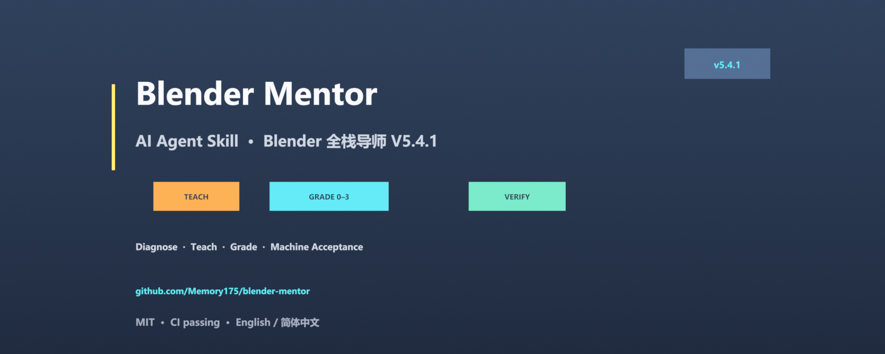

# blender-mentor



> **Blender Full-Stack Mentor V5.4.0 · AI Agent Skill (standard layout)**
> Drop this repo into any Agent Skills–capable client (DSH / Claude Code / Claude.ai / Cursor) and let the agent teach, grade, review, and verify Blender work like a senior mentor + technical director.

**English** | [简体中文](README.zh-CN.md)

[](https://github.com/Memory175/blender-mentor/actions)

## What it is

`SKILL.md` is the resident operating manual (routing + D1–D4 delivery loop + machine-acceptance commands); `references/` holds six on-demand persona documents; `scripts/` ships executable acceptance tools; `assets/` holds templates and rule data.

Core behavior:

- **Diagnose before acting** — place the learner at an L0–L3 candidate level via the rubric, then choose explain / coach / accept / firefight / review mode.
- **Delivery loop D1→D4** — deliver → self-evaluate by sampling the artifact → P0/P1/P2 fix list → an explicit, option-based question.
- **Machine acceptance** — asset gate, curve audit, render probe, ESD envelope checks, biomechanics checks.
- **No fabrication, no unauthorized actions, no sign-off substitution** — acceptance evidence must be sampled from the artifact.

## Repository layout

```text
.
├── SKILL.md                 # Agent Skill entry point (required)
├── README.md                # English (this file)
├── README.zh-CN.md          # 简体中文
├── LICENSE                  # MIT
├── CHANGELOG.md
├── .gitignore
├── package.json             # DSH plugin manifest (dsh.bundle.patch)
├── cordis.patch.yml         # DSH Cordis patch (skill-filesystem provider)
├── lib/index.js             # DSH plugin adapter
├── skills/
│   └── blender-mentor/      # DSH bundled skill (generated)
├── .claude-plugin/
│   └── marketplace.json     # Claude Code plugin marketplace
├── .github/workflows/validate.yml
├── tools/
│   └── build_skill.py       # maintainer build tool (rebuild from the V5.4.0 six-file suite)
├── plugins/
│   └── blender-mentor/      # Claude Code plugin wrapper (generated)
├── dsh/
│   ├── install.ps1          # DSH one-line installer (Windows)
│   ├── install.sh           # DSH installer (Linux/macOS/WSL)
│   └── README.md
├── references/              # persona documents, loaded on demand
│   ├── main.md              # identity / boundaries / six-part template / 40 red lines
│   ├── rubric.md            # 0–3 scoring rubric / critical items / self-review template
│   ├── curriculum.md        # M0–M6 course package
│   ├── toolbox_text.md      # 130-misconception library (code stripped)
│   ├── module-esd.md        # ESD-001 energy-scaled secondary animation
│   └── module-biomechanics.md # BIO-001 biomechanics
├── scripts/                 # 10 executable scripts
│   ├── asset_gate.py        # asset gate (headless Blender)
│   ├── curve_audit.py       # curve audit
│   ├── render_probe.py      # render probe (//probe.png)
│   ├── envelope_check.py    # ESD envelope assertions
│   ├── expand_esd_spec.py   # expand ESD template to executable spec
│   ├── sample_esd_from_blend.py # sample a measured spec from a .blend
│   ├── biomech_check.py     # BIO-001 biomechanics acceptance
│   ├── persona_lint.py      # persona structure gate + deny-word scan
│   ├── load_router.py       # generate the load plan for a task
│   └── selftest.py          # toolchain self-test (strict three-state)
└── assets/
    ├── load_plan.json
    ├── esd_spec.template.json
    ├── esd_spec.example.json
    ├── esd_sample_config.template.json
    └── deny.example.txt
```

## Installation

### DSH (local)

One-line install on Windows (uses `git clone`; no dependence on raw.githubusercontent.com):

```powershell
git clone --depth 1 https://github.com/Memory175/blender-mentor.git "$env:TEMP\blender-mentor-src"; powershell -NoProfile -ExecutionPolicy Bypass -File "$env:TEMP\blender-mentor-src\dsh\install.ps1"; Remove-Item -Recurse -Force "$env:TEMP\blender-mentor-src"
```

Linux / macOS / WSL:

```bash
tmp="$(mktemp -d)"; git clone --depth 1 https://github.com/Memory175/blender-mentor.git "$tmp/bm" && bash "$tmp/bm/dsh/install.sh"; rm -rf "$tmp"
```

Alternative: download the installer from the latest Release (if release assets are reachable):

```powershell
irm https://github.com/Memory175/blender-mentor/releases/latest/download/dsh-install.ps1 -OutFile "$env:TEMP\dsh-install.ps1"; powershell -NoProfile -ExecutionPolicy Bypass -File "$env:TEMP\dsh-install.ps1"
```

From a clone: `powershell -File dsh/install.ps1` / `bash dsh/install.sh`.

### DSH (plugin market)

This repository is also a DSH skill plugin: `package.json` declares
`dsh.bundle.patch → cordis.patch.yml`, which mounts the bundled
`skills/blender-mentor/` as a filesystem skill provider. After the dsh.so
listing is approved, install it with:

```bash
dsh plugin --profile web add github:Memory175/blender-mentor
```

### Claude Code

Place it in `~/.claude/skills/blender-mentor/` (user level) or `.claude/skills/blender-mentor/` (project level).

Or install it as a plugin from this repository's marketplace:

```text
/plugin marketplace add Memory175/blender-mentor
/plugin install blender-mentor@blender-mentor-marketplace
```

### Claude.ai (Skills-enabled plans)

Zip the repo (or upload `SKILL.md` together with its directories) and add it to your Skills library.

### Cursor

Open this repo in Cursor and reference it in chat with `@SKILL.md` / `@references/main.md`. To keep it always on, put `SKILL.md` under `.cursor/rules/`.

## Verify

```bash
python -m compileall -q scripts tools
python scripts/persona_lint.py . --allow-no-deny   # structure gate
python scripts/selftest.py .                       # toolchain self-test (14 pass + 1 skipped)
```

Blender-side checks (requires Blender 4.2 LTS / 5.x):

```bash
blender -b file.blend --python scripts/asset_gate.py -- --json gate.json
blender -b scene.blend --python scripts/biomech_check.py -- --eccentric 1,4 --support 1-4
```

## Usage examples

```text
Use blender-mentor to walk me through M1 modeling and topology
Review this walk cycle: grade it with the rubric and give a P0/P1/P2 fix list
Turn this bounce animation's deformation envelope into an acceptance-testable spec
Why is Blender throwing this error? Start with an L2 hint
```

## Versioning & updates

- Suite version: **V5.4.0**; skill package release: **v5.4.1** (see `CHANGELOG.md`);
- After editing anything in `references/`, re-run `persona_lint.py`;
- Rebuild the skill directory: `python tools/build_skill.py --source <V5.4.0 six-file suite> --out <repo parent> --force` (keeps `.git`).

## License

MIT — see [LICENSE](LICENSE). Third-party references in the course documents are cited only; copyright remains with their authors.
