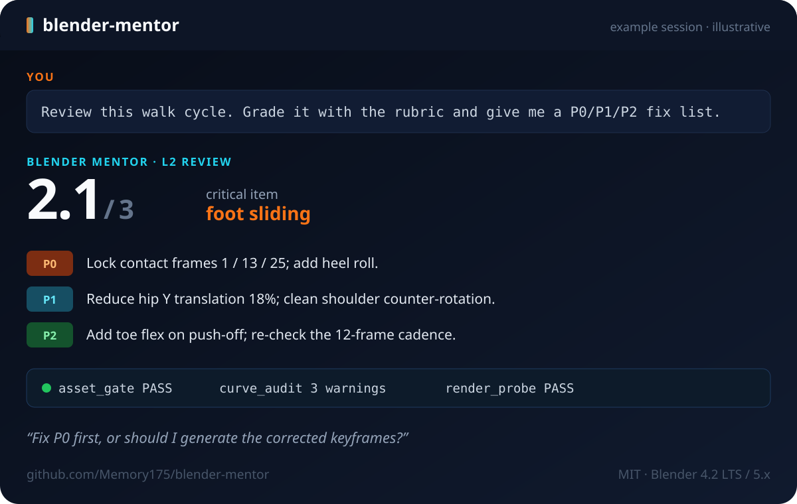

# Blender Mentor

**把 Claude Code / DSH / Cursor 变成一位 Blender 资深导师 + 技术总监。**

先诊断你的水平，再用结构化课程带你做；交付后用 0–3 评分表打分，并对你的 `.blend` 跑机器验收——资产、曲线、渲染、ESD 次级动画、生物力学。

**简体中文** | [English](README.md)

[](https://github.com/Memory175/blender-mentor/actions)
[](https://github.com/Memory175/blender-mentor/releases)
[](https://github.com/Memory175/blender-mentor/blob/main/LICENSE)
[](https://www.blender.org/download/)

## 实际效果

```text
你   › 帮我审这个走路循环，按评分表打分并给 P0/P1/P2 修改清单。

导师 › L2 · Review 模式 · 评分 2.1 / 3 — 关键项：脚底滑动
       P0  锁定 1 / 13 / 25 帧接触点；补脚跟滚动。
       P1  髋部 Y 位移减少 18%；清理肩部反向旋转。
       P2  蹬地阶段加脚趾弯曲；重新核对 12 帧步频。
       验收  asset_gate PASS · curve_audit 3 warnings · render_probe PASS
```



> **这不是 Blender 插件。** 技能给 AI 客户端装上导师的“工作手册”；打开 `.blend` 和跑验收脚本仍然需要你本机安装 Blender 4.2 LTS / 5.x。

## 评分速览

| 分数 | 含义 | 走路循环示例 |
|---|---|---|
| **0** | 关键项一票否决 | 脚底滑动 → 0 分，无论其他项多好都不通过 |
| **2** | 达标、可交付 | 接触点锁定、无穿帮 |
| **3** | 生产级 | 接触点锁定 + 脚跟滚动 + 步频可复用 |

完整评分锚点与自评模板：[`references/rubric.md`](references/rubric.md)。

## 快速开始

**DSH** — 克隆并安装（Windows / Linux / macOS / WSL）：

```bash
git clone --depth 1 https://github.com/Memory175/blender-mentor.git
cd blender-mentor

# Windows
powershell -NoProfile -ExecutionPolicy Bypass -File dsh/install.ps1

# Linux / macOS / WSL
bash dsh/install.sh
```

**Claude Code** — 作为插件安装：

```text
/plugin marketplace add Memory175/blender-mentor
/plugin install blender-mentor@blender-mentor-marketplace
```

**Cursor / 其他 Agent Skills 客户端** — 克隆仓库，让你的客户端加载 `SKILL.md`（Cursor 里可用 `@SKILL.md`；想常驻就加一条指向它的项目规则）。

然后新开一个 agent 会话，直接说：

```text
用 blender-mentor 带我过 M1 建模与拓扑。
```

## 包含什么

| 组成 | 作用 |
|---|---|
| **导师行为** | L0–L3 水平诊断；讲解 / 教练 / 验收 / 救火 / 评审 五种模式 |
| **D1–D4 交付闭环** | 交付 → 自评 → P0/P1/P2 修改清单 → 明确的下一步问题 |
| **0–3 评分表** | 关键项、评分锚点、自评模板 |
| **M0–M6 课程包** | 建模与拓扑 → UV/材质/灯光/渲染 → 动画/绑定 → 物理/几何节点/管线 |
| **10 个验收脚本** | 资产门、曲线审计、渲染探针、ESD 包络、生物力学、路由、lint、自检 |
| **知识库** | 130 条常见误区 + 40 条红线 |

## 环境要求

| 需要 | 用途 |
|---|---|
| Blender 4.2 LTS / 5.x | `.blend` 验收脚本（`blender -b ... --python scripts/...`） |
| Claude Code / DSH / Claude.ai / Cursor | 加载技能 |
| Python 3 | `selftest.py`、`persona_lint.py`、`load_router.py` |

## 工作原理

```text
SKILL.md       路由 + D1–D4 交付闭环 + 机器验收命令
references/    6 份人设文档，按需加载
scripts/       10 个可执行验收工具
assets/        ESD 模板、加载清单、拒绝词示例
```

1. `SKILL.md` 负责路由，并设定交付闭环。
2. `load_router.py` 生成该任务的加载清单，只加载相关 references。
3. 验收脚本通过无头 Blender 操作你本地的 `.blend`。
4. 文件不出本机；验收工具不会上传任何内容。

<details>
<summary><strong>高级安装方式</strong></summary>

### Claude.ai

把技能目录（`SKILL.md` + `references/`、`scripts/`、`assets/`）打成 zip，上传到 Skills 库。

### DSH 插件市场

本仓库同时是 DSH 技能插件：`package.json` 声明 `dsh.bundle.patch → cordis.patch.yml`，挂载内置的 `skills/blender-mentor/`。dsh.so 收录通过后可用：

```bash
dsh plugin --profile web add github:Memory175/blender-mentor
```

### 下载安装脚本

`dsh-install.ps1` / `dsh-install.sh` 已附在 [latest release](https://github.com/Memory175/blender-mentor/releases/latest)；不想 clone 时可直接下载运行。

</details>

<details>
<summary><strong>仓库结构</strong></summary>

```text
.
├── SKILL.md                     # Agent Skill 入口（必须）
├── README.md / README.zh-CN.md  # English / 简体中文
├── LICENSE                      # MIT
├── CHANGELOG.md
├── package.json                 # DSH 插件清单（dsh.bundle.patch）
├── cordis.patch.yml             # DSH Cordis 补丁（skill-filesystem provider）
├── lib/index.js                 # DSH 插件适配器
├── skills/blender-mentor/       # DSH 内置技能（自动生成）
├── .claude-plugin/marketplace.json
├── plugins/blender-mentor/      # Claude Code 插件包装（自动生成）
├── dsh/install.ps1 / install.sh # DSH 一键安装脚本
├── references/                  # 6 份人设文档，按需加载
├── scripts/                     # 10 个可执行验收脚本
├── assets/                      # ESD 模板、加载清单、拒绝词示例
├── docs/                        # banner + 示例会话图
└── tools/build_skill.py         # 维护侧构建工具
```

</details>

## 常见问题

**这是 Blender 插件吗？**
不是。它是 Agent Skill：给 AI 客户端加载的指令 + 脚本；Blender 需要另外安装。

**需要先装 Blender 吗？**
只做教学、点评和规划不需要；要打开 `.blend`、跑渲染探针和机器验收时需要 Blender 4.2 LTS / 5.x。

**它会控制 Blender 界面吗？**
不会。它编写并执行 bpy/无头脚本，审查你提供的产物；不会替你点鼠标建模。

**我的 `.blend` 会被上传吗？**
不会。验收脚本在本机运行，输出 JSON/文本，不上传文件。

**支持哪些客户端？**
DSH、Claude Code、Claude.ai、Cursor，以及任何支持标准 Agent Skills 布局（`SKILL.md` + 资源目录）的客户端。

**为什么同时看到 V5.4.0 和 v5.4.4？**
V5.4.0 是人设套件版本（六份源文档）；v5.4.4 是打包后的技能发布版本，两者独立版本号。

## 开发与验证

```bash
python -m compileall -q scripts tools
python scripts/persona_lint.py . --allow-no-deny   # 结构门
python scripts/selftest.py .                       # 14 pass + 1 skipped
```

Blender 侧检查：

```bash
blender -b file.blend --python scripts/asset_gate.py -- --json gate.json
blender -b scene.blend --python scripts/biomech_check.py -- --eccentric 1,4 --support 1-4
```

重建技能目录：

```bash
python tools/build_skill.py --source <V5.4.0 六件套目录> --out <仓库父目录> --force
```

## 许可

MIT，见 [LICENSE](LICENSE)。课程文档中的第三方参考书目仅作引用，版权归原作者。

---

如果这个技能帮你省了时间，点个 ⭐ 能让更多人找到它 · [反馈问题](https://github.com/Memory175/blender-mentor/issues) · [Release](https://github.com/Memory175/blender-mentor/releases)
